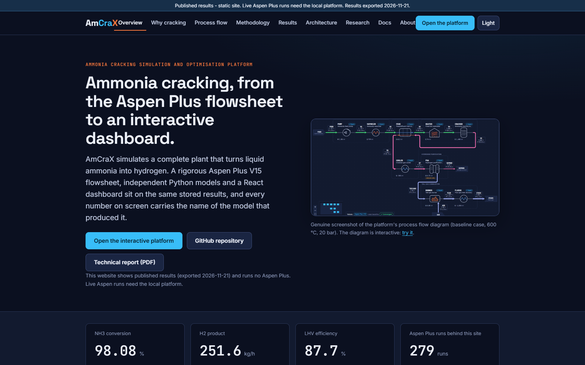
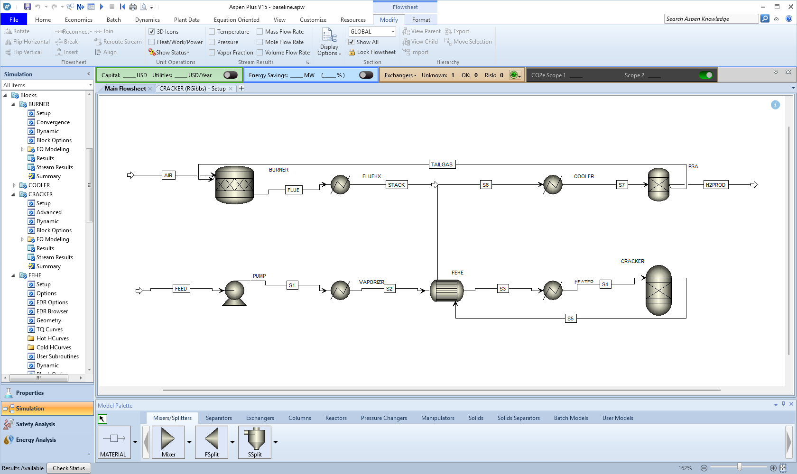
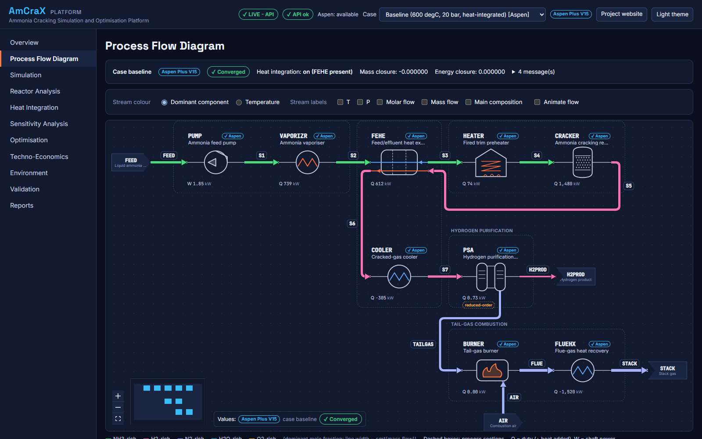
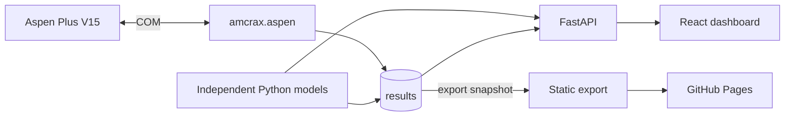
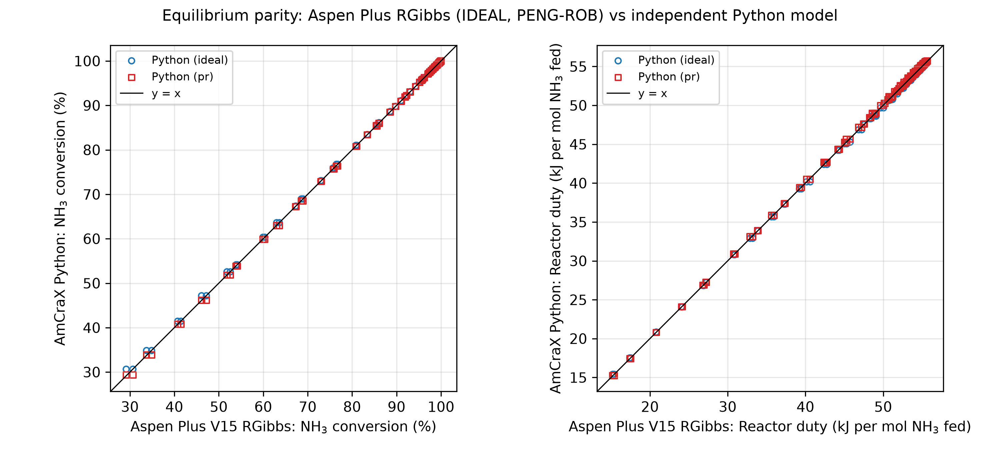
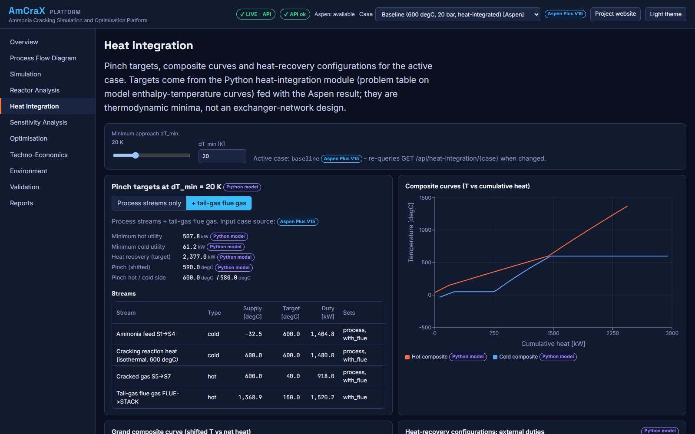
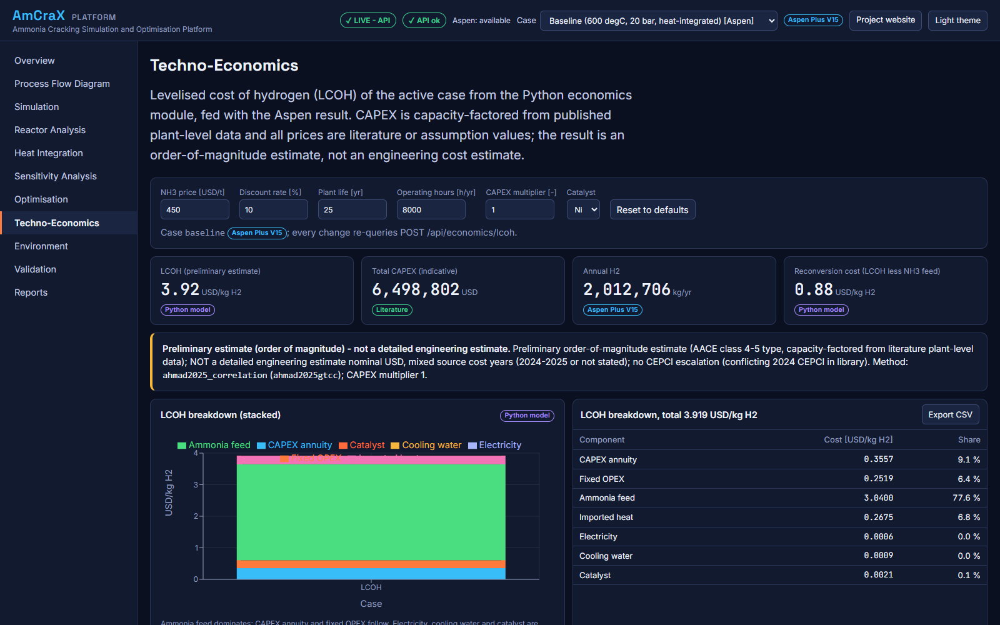
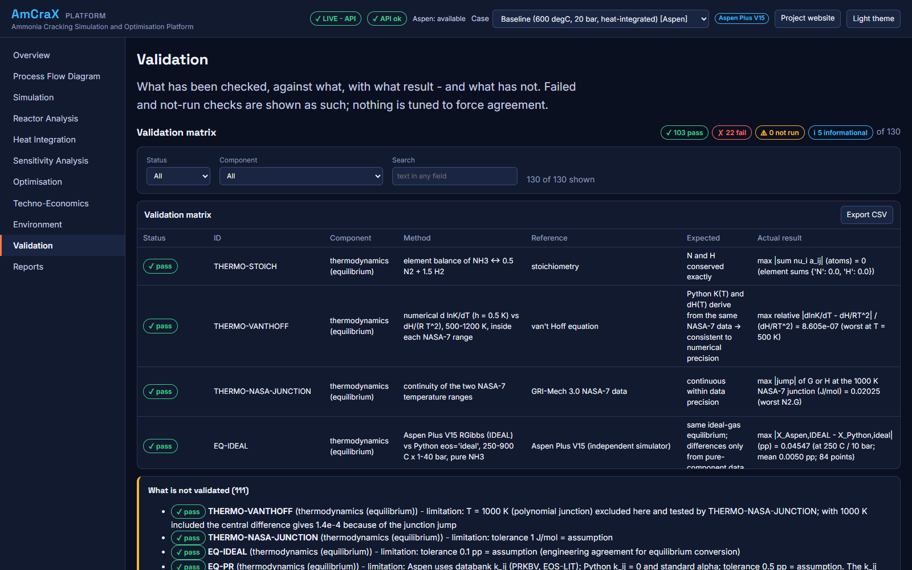

# AmCraX: ammonia cracking simulation and optimisation platform

<p align="center">
  <a href="LICENSE"></a>
  <a href="https://github.com/weewzr/AmCraX/actions/workflows/deploy-pages.yml"></a>
  
</p>

<p align="center">
  <a href="https://weewzr.github.io/AmCraX/">Live site</a> |
  <a href="https://weewzr.github.io/AmCraX/#/platform/pfd">Interactive platform</a> |
  <a href="docs/technical_report/AmCraX_Technical_Report.pdf">Technical report</a> |
  <a href="docs/README.md">Documentation</a> |
  <a href="https://weewzr.github.io/weewzr/projects/amcrax/">Portfolio page</a>
</p>

AmCraX simulates the decomposition of ammonia into hydrogen. An Aspen Plus V15 flowsheet is driven through COM, independent Python models cross-check it, and a FastAPI service and React dashboard show every result with the name of the model that produced it.

<p align="center"></p>

<details>
<summary>Contents</summary>

- [What AmCraX is and why](#what-amcrax-is-and-why)
- [Key features](#key-features)
- [The process in brief](#the-process-in-brief)
- [Scientific methodology](#scientific-methodology)
- [Aspen Plus integration](#aspen-plus-integration)
- [Software architecture](#software-architecture)
- [Technology stack](#technology-stack)
- [Status and validation](#status-and-validation)
- [Prerequisites](#prerequisites)
- [Installation and running locally](#installation-and-running-locally)
- [Usage examples](#usage-examples)
- [Results](#results)
- [Documentation](#documentation)
- [Research references](#research-references)
- [Roadmap](#roadmap)
- [Known limitations](#known-limitations)
- [Contributing](#contributing)
- [How to cite](#how-to-cite)
- [Licence and acknowledgements](#licence-and-acknowledgements)

</details>

## What AmCraX is and why

Ammonia carries 17.8 wt% hydrogen (3 x 1.008 / 17.031) and is easier to ship than hydrogen itself. At the destination it has to be cracked back: NH3 -> 1/2 N2 + 3/2 H2, an endothermic reaction with a standard enthalpy of 45.6 to 46.2 kJ per mol NH3 in the reviewed papers (Cechetto et al., 2023; Cho et al., 2026). The cracker, its heat integration and the purification of the hydrogen decide the cost and efficiency of this step.

AmCraX lets a student or engineer explore that design space with an auditable chain from model to number. It shows how conversion depends on temperature and pressure, how much heat the process needs and how much the feed/effluent exchanger recovers, what a purification route does to purity, and what hydrogen costs and emits under stated assumptions. The scope is steady state, 100 kmol/h of liquid ammonia, a 600 degC and 20 bar baseline, and a PSA hydrogen recovery of 0.85.

## Key features

- Aspen Plus V15 flowsheet built and solved by script, with 279 converged runs behind the stored results.
- Independent Python models: equilibrium, flowsheet mirror, pinch analysis, kinetics and plug-flow reactor, PSA and membrane purification, techno-economics, carbon intensity, optimisation, scenarios.
- A FastAPI service ([docs/api.md](docs/api.md)) and an 11-page React dashboard with an interactive process diagram.
- A provenance label on every value (`aspen_plus_v15`, `python_model`, `literature`, `assumption`, `demo`).
- A static public site that runs from the published results without Aspen Plus.

## The process in brief

Refrigerated liquid ammonia (99.8 mol% NH3, 0.2 mol% H2O) is pumped, vaporised and heated against the hot cracker effluent in a feed/effluent exchanger (FEHE), trimmed by a fired heater and cracked in an isothermal Gibbs reactor at 600 degC and 20 bar. The effluent is cooled to 40 degC and a pressure swing adsorption block (PSA, modelled as a component splitter) delivers the hydrogen product. The PSA tail gas is burned with 15 % excess air and the flue gas is cooled to a 150 degC stack. The property method is PENG-ROB.

<p align="center"></p>


<p align="center"></p>

## Scientific methodology

The Aspen Plus V15 model is the reference. Its results (streams, block duties, mass and energy closure) are extracted to JSON and CSV with a provenance label. The Python models are written independently of Aspen Plus and check it in these ways:

- Equilibrium, like for like: Aspen IDEAL against Python ideal agree to 0.045 percentage points in conversion at most, and Aspen PENG-ROB against Python Peng-Robinson to 0.185 percentage points, over a 168-point RGibbs grid. Thermochemistry is compared with NIST-JANAF.
- Flowsheet: the Python mirror reproduces the primary quantities (conversion, cracked-gas composition, reactor duty) for all 20 stored cases.
- Physics checks outside Aspen Plus: flame temperature and flue-gas duty against Cantera, pump power by hand, exchanger UA against Q/LMTD.
- Optimisation: the optima are found on the fast Python model, and all 10 reported candidates were re-solved in Aspen Plus V15.

Literature values are never shown as AmCraX results and nothing is tuned to force agreement ([docs/model_assumptions.md](docs/model_assumptions.md)).

## Aspen Plus integration

`amcrax.aspen` starts Aspen Plus through COM (ProgID `Apwn.Document.41.0`), writes a model as an Aspen input file from a `CaseInputs` object, solves it with `Engine.Run2` after a reinitialisation and extracts the results. Runs are synchronous, one automation instance runs at a time under a lock file, and the API runs Aspen in a separate worker process. Without Aspen Plus the API answers 503 `aspen_unavailable` and never substitutes a Python result for an Aspen request.

Aspen Plus V15 with a licence seat is needed to generate new rigorous results. Reading the stored results, the Python models, the dashboard and the tests need no licence.

## Software architecture



The API never imports COM. The static export (`scripts/export_snapshot.py`) feeds the public site, which is built by `npm run build:pages` and reads only published results.

## Technology stack

| Layer | Technology |
|---|---|
| Process simulation | Aspen Plus V15 (commercial), COM automation with pywin32 |
| Python models and API | Python 3.12, NumPy, SciPy, Pydantic, FastAPI, CoolProp, Cantera |
| Dashboard and site | React 19, TypeScript, Vite, React Flow, Recharts |
| Tests | pytest, vitest |
| Deployment | GitHub Pages, GitHub Actions |

Versions: [docs/dependencies.md](docs/dependencies.md).

## Status and validation

The validation matrix (`results/validation/validation_matrix.json`, generated 2026-11-21) has 137 items: 105 pass, 22 fail, 0 not run and 10 informational. The failures are kept and reported. They have two causes:

- 20 flowsheet cross-check items (`FS-<case>`): the Python and Aspen models use different property models in the feed section (Aspen PENG-ROB; Python a reference equation of state for ammonia and an ideal-liquid dew point). The duties differ by 3 to 10 %. This measures a model-form difference and is not evidence that either model is the weaker one. The primary quantities pass for all 20 cases.
- 2 kinetics items (`KIN-NI-PRED`, `KIN-RU-PRED`): published conversion curves are reproduced within about 0.11 against a tolerance of 0.05.

Tests: 513 Python tests pass and 1 opt-in live-Aspen test is skipped (2026-11-23, after the research expansion below); 107 frontend unit tests pass (2026-11-23). A feature-by-feature check is in [docs/verification_matrix.md](docs/verification_matrix.md) and the matrix itself in [docs/validation/validation_matrix.md](docs/validation/validation_matrix.md).

<p align="center"></p>

## Research expansion: Singapore-specific hypothesis tests

A research expansion tests four hypotheses on end-use suitability, ammonia feedstock, catalyst and heat integration, and purification for Singapore (Jurong Island as a representative industrial setting; no facility is claimed). It adds, without changing the existing results or behaviour:

- Catalyst kinetics in the Python reactor model and as an Aspen Plus RPlug cracker, standalone and in the full flowsheet. 162 new Aspen Plus V15 runs were made and all 162 finished with status `ok` (`results/research/aspen_kinetic/run_status.json`).
- Catalysts actually modelled: Ru/Al2O3 (Kum), 5Ni1Ru/CeO2 and 2.5Ni0.5Ru/CeO2 (Lucentini 2021), and Ni/MgO and Ru/MgO through a fitted approximation of the Takahashi law (valid at 20 bar only). Ni/CeO2, Ru/CeO2 and Ru-K/CaO are not modelled: no usable published rate law was available.
- A Singapore techno-economic model with sourced prices, a catalyst and heat-integration comparison, a purification study against ISO 14687, an end-use comparison and a life-cycle assessment.
- A research validation summary kept separate from the core matrix: 350 items, 295 pass, 10 fail and 45 informational (`results/research/validation/summary.json`). The failures are kept and explained.
- Aspen Plus screenshots under `docs/images/aspen_evidence/`, each inspected (31 of 31 pass; one was recaptured on 2026-11-23 after its first capture showed the wrong tab).

Rate laws are fitted at 1 atm or up to 10 bar and extrapolated to 20 bar, and the CAPEX model does not respond to temperature or reactor volume. Verdicts for the four hypotheses are in the [evidence matrix](docs/research/evidence_matrix.md) (generated from `results/research/evidence_matrix.json`); they are not repeated here. See [docs/research/README.md](docs/research/README.md) for the index and reproduction commands, [docs/research/validation_and_limitations.md](docs/research/validation_and_limitations.md) for validation, limitations and inaccessible sources, and [docs/validation/research_validation.md](docs/validation/research_validation.md) for every research validation failure.

## Prerequisites

| For | You need | Notes |
|---|---|---|
| Everything | Windows 10 or 11, PowerShell 5.1, Python 3.12, Node 24 | Quote the project path if it contains spaces. |
| Live Aspen runs only | Aspen Plus V15 with a licence seat | Not included. One job at a time. |
| Report and deck tooling only | pandoc, Microsoft Word or PowerPoint, Microsoft Edge | Optional. |

## Installation and running locally

From the repository root in PowerShell:

```powershell
powershell -ExecutionPolicy Bypass -File scripts\setup.ps1   # virtual environment, pip and npm dependencies; safe to repeat
scripts\start_amcrax.ps1                                      # API and dashboard; opens the browser
scripts\stop_amcrax.ps1                                       # stops what start_amcrax.ps1 started
```

The dashboard is at <http://localhost:5173> and the API documentation at <http://127.0.0.1:8000/docs>. The header shows the data mode: LIVE (API reachable), SNAPSHOT (stored export, read-only) or DEMO (placeholders under a red banner, never results). Without Aspen Plus the dashboard shows every stored Aspen result and offers the Python model for new cases. More: [docs/installation.md](docs/installation.md).

## Usage examples

**From the dashboard.** Open Simulation, set the operating conditions, choose the Python model or Aspen Plus V15 and submit. The job moves through `queued` and `running` to `succeeded`, `failed` or `timeout`, and the case appears in the case selector.

**Baseline from the command line.** The first command needs Aspen Plus and solves the baseline and the variant without the exchanger. The second uses the Python model only.

```powershell
. scripts\env.ps1
python aspen\automation\run_baseline.py
python scripts\run_python_baseline.py
```

**Python.** `amcrax.process_model.run_python_case(inputs, eos="ideal")` runs the independent model and `amcrax.aspen.run_case(inputs)` runs the same `CaseInputs` in Aspen Plus. The first needs no licence:

```python
from amcrax.schemas import CaseInputs
from amcrax.process_model import run_python_case

result = run_python_case(CaseInputs(case_id="demo", reactor_temperature_C=600, reactor_pressure_bar=20))
k = result.kpis
print(result.source.value)
print(f"NH3 conversion   {k.nh3_conversion:.4f}")
print(f"H2 product       {k.h2_product_kg_h:.1f} kg/h")
print(f"External heating {k.total_external_heating_kW:.0f} kW")
print(f"LHV efficiency   {k.lhv_efficiency:.3f}")
```

Output of this snippet on 2026-11-21:

```text
python_model
NH3 conversion   0.9809
H2 product       251.6 kg/h
External heating 2265 kW
LHV efficiency   0.880
```

The Aspen baseline gives 2293 kW and 0.877 for the last two lines. Other studies: [docs/reproducing.md](docs/reproducing.md).

## Results

Baseline case, 600 degC, 20 bar, 100 kmol/h feed:

| Quantity | Value | Source |
|---|---|---|
| NH3 conversion | 0.9808 | Aspen Plus V15, `results/simulations/baseline.json` |
| Hydrogen product | 251.6 kg/h, 99.961 mol% H2 | same; purity follows from the assumed PSA split |
| External heating | 2293 kW (2905 kW without the exchanger) | same and `baseline_no_hi.json` |
| Heat recovered in the exchanger | 612 kW | same |
| LHV efficiency | 0.877 (0.824 without the exchanger) | same; first-law upper bound |
| Levelised cost of hydrogen | 3.92 USD/kg at 450 USD/t NH3 | Python model, `economics_baseline.json`; preliminary |
| Carbon intensity | 0.41 kg CO2e/kg H2 (green NH3, self-fired heat); 19.5 (grey NH3) | Python model, `environmental_baseline.json`; simplified accounting |

The 99.961 mol% purity (392 ppm N2) is below the 99.97 % limit quoted for fuel-cell hydrogen and NH3 polishing is not modelled, so the baseline product is not fuel-cell grade. All 10 optimisation candidates converged in Aspen Plus, with primary metrics within 1.15 % of the Python model. The live results page is <https://weewzr.github.io/AmCraX/#/results>.

<table>
  <tr>
    <td></td>
    <td></td>
    <td></td>
  </tr>
</table>

## Documentation

| Document | Contents |
|---|---|
| [docs/README.md](docs/README.md) | Index of the documentation |
| [docs/installation.md](docs/installation.md) | Setup, launch, running without Aspen Plus, troubleshooting |
| [docs/user_guide.md](docs/user_guide.md) | The dashboard pages and data modes |
| [docs/reproducing.md](docs/reproducing.md) | Commands that regenerate every result |
| [docs/api.md](docs/api.md) | HTTP endpoints and job life-cycle |
| [docs/known_limitations.md](docs/known_limitations.md) | Limitations with consequences and remedies |
| [docs/verification_matrix.md](docs/verification_matrix.md) | Feature-by-feature verification |
| [docs/technical_report/AmCraX_Technical_Report.pdf](docs/technical_report/AmCraX_Technical_Report.pdf) | Technical report |

## Research references

Selected sources in APA style. The full list is in [research/references_apa.md](research/references_apa.md).

- Cechetto, V., Di Felice, L., & Gallucci, F. (2023). Advances and perspectives of H2 production from NH3 decomposition in membrane reactors. *Energy & Fuels, 37*(15), 10775-10798. <https://doi.org/10.1021/acs.energyfuels.3c00760>
- Cho, S., Lee, Y., & Lee, I. (2026). Comparative assessment of ammonia decomposition processes based on nickel and ruthenium catalysts: A techno-economic perspective. *Energy Conversion and Management, 348*, 120796. <https://doi.org/10.1016/j.enconman.2025.120796>
- Devkota, S., Cha, J.-Y., Shin, B.-J., Mun, J.-H., Yoon, H. C., Mazari, S. A., & Moon, J.-H. (2024). Techno-economic and environmental assessment of hydrogen production through ammonia decomposition. *Applied Energy, 358*, 122605. <https://doi.org/10.1016/j.apenergy.2023.122605>
- Kum, J., Ko, Y., Chang, J. H., & Lee, C.-H. (2026). Dynamic modeling and techno-economic analysis of a heat-integrated NH3 cracking plant for cost-effective H2 production under uncertainty. *Applied Energy, 406*, 127210. <https://doi.org/10.1016/j.apenergy.2025.127210>
- Takahashi, A., & Fujitani, T. (2016). Kinetic analysis of decomposition of ammonia over nickel and ruthenium catalysts. *Journal of Chemical Engineering of Japan, 49*(1), 22-28. <https://doi.org/10.1252/jcej.14we431>

## Roadmap

These are the next steps named in [docs/known_limitations.md](docs/known_limitations.md). No dates are set.

- Rate laws for Ni/CeO2, Ru/CeO2 and Ru-K/CaO, which could not be modelled because no usable published rate law was obtained. The Aspen Plus RPlug reactor now exists for the research cases (see the research expansion section above); the baseline flowsheet still uses the equilibrium reactor.
- Designed PSA and TSA purification units, for example in Aspen Adsorption, instead of the component splitter.
- Cracked-gas compression and NH3 polishing in the flowsheet.
- Equipment-level costing in place of the plant-level CAPEX correlation.
- Kinetics fitted or validated at high pressure, resolving the two failing kinetics items.

## Known limitations

- The Aspen reactor is an equilibrium reactor, so conversion is an upper bound. The model is steady state only.
- The PSA is a reduced-order splitter whose recovery (0.85) is above the 0.71 to 0.81 literature range. NH3 polishing and compression are not in the flowsheet.
- Kinetics were fitted at 1 atm (Takahashi) or up to 10 bar (Kum) and are extrapolated to 20 bar.
- Costs are a preliminary plant-level estimate in mixed 2024 to 2025 USD. Published values at a comparable ammonia price are 5.1 to 6.4 USD/kg, and AmCraX omits NOx treatment, NH3 polishing, compression and installed-cost factors.
- Carbon accounting is simplified and is not a life-cycle assessment.
- Live Aspen runs need Windows and one licence seat. The servers are for development, without authentication.

What AmCraX does not claim: it is not a validated digital twin, there is no plant data behind it, and the PSA, membrane, cost and carbon models are not validated.

## Contributing

Read [CONTRIBUTING.md](CONTRIBUTING.md) first. A change is judged on whether its numbers can be trusted: no invented numbers, no tuning to force agreement, and no weakening of a failing check.

## How to cite

Cite the software with the metadata in [CITATION.cff](CITATION.cff). GitHub shows it under "Cite this repository".

## Licence and acknowledgements

The project's own code and documents are under the [MIT licence](LICENSE). Aspen Plus is commercial software of Aspen Technology and is not included. The research papers are copyrighted, excluded from version control and not redistributed. Third-party software keeps its own licences ([docs/dependencies.md](docs/dependencies.md)), including [CoolProp](http://www.coolprop.org/), [Cantera](https://cantera.org/), [FastAPI](https://fastapi.tiangolo.com/), [React](https://react.dev/), [React Flow](https://reactflow.dev/), [Vite](https://vite.dev/) and [Recharts](https://recharts.org/). The author is Wee Zhern Ray; see the [portfolio page](https://weewzr.github.io/weewzr/projects/amcrax/).
