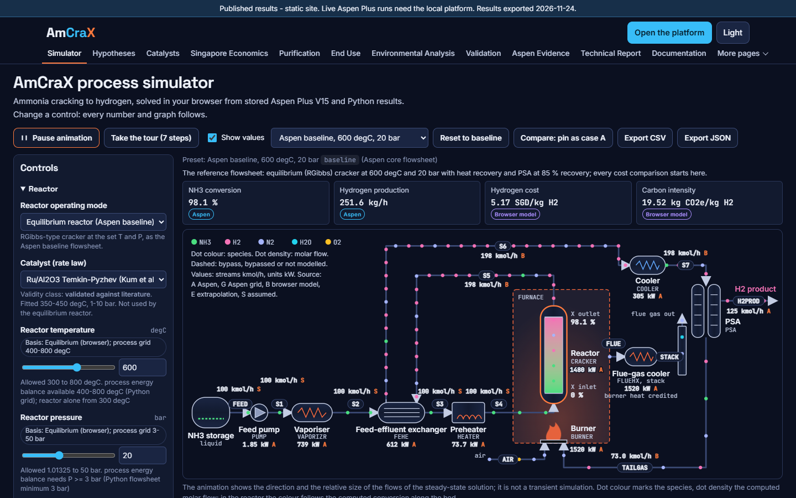
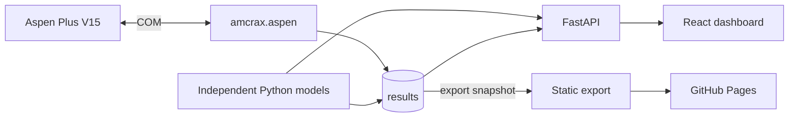

# AmCraX: ammonia cracking simulation and optimisation platform

<p align="center">
  <a href="LICENSE"></a>
  <a href="https://github.com/weewzr/AmCraX/actions/workflows/deploy-pages.yml"></a>
  
</p>

<p align="center">
  <a href="https://weewzr.github.io/AmCraX/">Interactive simulator (live site)</a> |
  <a href="https://weewzr.github.io/AmCraX/#/hypotheses">Hypothesis evidence</a> |
  <a href="https://weewzr.github.io/AmCraX/#/platform/pfd">Platform pages</a> |
  <a href="docs/technical_report/AmCraX_Technical_Report.pdf">Technical report</a> |
  <a href="docs/README.md">Documentation</a> |
  <a href="https://weewzr.github.io/weewzr/projects/amcrax/">Portfolio page</a>
</p>

AmCraX simulates the decomposition of ammonia into hydrogen. An Aspen Plus V15 flowsheet is driven through COM, independent Python models cross-check it, and a FastAPI service and React dashboard show every result with the name of the model that produced it.

Phase 2 (23 November 2026) puts an interactive process simulator on the first page of the website. It runs in the browser, with no server. Every number on it is labelled as a stored Aspen Plus result, an interpolation of stored results, a browser-model value (code tested against the Python model), an extrapolation or an assumption. The animation shows flow direction only and is not a transient simulation. Phase 2 also moves all economics onto one reference scenario and tests four hypotheses on a stricter, documented verdict rule.

<p align="center"></p>

<details>
<summary>Contents</summary>

- [What AmCraX is and why](#what-amcrax-is-and-why)
- [Key features](#key-features)
- [The process in brief](#the-process-in-brief)
- [Scientific methodology](#scientific-methodology)
- [Aspen Plus integration](#aspen-plus-integration)
- [Software architecture](#software-architecture)
- [Technology stack](#technology-stack)
- [The interactive simulator](#the-interactive-simulator)
- [Status and validation](#status-and-validation)
- [Research expansion and Phase 2](#research-expansion-and-phase-2-singapore-specific-hypothesis-tests)
- [Prerequisites](#prerequisites)
- [Installation and running locally](#installation-and-running-locally)
- [Usage examples](#usage-examples)
- [Results](#results)
- [Documentation](#documentation)
- [Research references](#research-references)
- [Roadmap](#roadmap)
- [Known limitations](#known-limitations)
- [Contributing](#contributing)
- [How to cite](#how-to-cite)
- [Licence and acknowledgements](#licence-and-acknowledgements)

</details>

## What AmCraX is and why

Ammonia carries 17.8 wt% hydrogen (3 x 1.008 / 17.031) and is easier to ship than hydrogen itself. At the destination it has to be cracked back: NH3 -> 1/2 N2 + 3/2 H2, an endothermic reaction with a standard enthalpy of 45.6 to 46.2 kJ per mol NH3 in the reviewed papers (Cechetto et al., 2023; Cho et al., 2026). The cracker, its heat integration and the purification of the hydrogen decide the cost and efficiency of this step.

AmCraX lets a student or engineer explore that design space with an auditable chain from model to number. It shows how conversion depends on temperature and pressure, how much heat the process needs and how much the feed/effluent exchanger recovers, what a purification route does to purity, and what hydrogen costs and emits under stated assumptions. The scope is steady state, 100 kmol/h of liquid ammonia, a 600 degC and 20 bar baseline, and a PSA hydrogen recovery of 0.85.

## Key features

- An interactive, browser-side process simulator as the first page of the public site (see below).
- Aspen Plus V15 flowsheet built and solved by script, with 279 converged runs behind the stored results.
- Independent Python models: equilibrium, flowsheet mirror, pinch analysis, kinetics and plug-flow reactor, PSA and membrane purification, techno-economics, carbon intensity, optimisation, scenarios, and (Phase 2) heat exchanger sizing, catalyst economics, carbon pricing, end use and uncertainty quantification.
- One unified techno-economic reference scenario (USD and SGD) used by every research workstream.
- Four hypotheses with an evidence matrix: row, component and hypothesis verdicts under a documented rule, with the earlier rule beside them.
- A FastAPI service ([docs/api.md](docs/api.md)) and an 11-page React dashboard with an interactive process diagram.
- A provenance label on every value (`aspen_plus_v15`, `python_model`, `literature`, `assumption`, `demo`).
- A static public site that runs from the published results without Aspen Plus.

## The process in brief

Refrigerated liquid ammonia (99.8 mol% NH3, 0.2 mol% H2O) is pumped, vaporised and heated against the hot cracker effluent in a feed/effluent exchanger (FEHE), trimmed by a fired heater and cracked in an isothermal Gibbs reactor at 600 degC and 20 bar. The effluent is cooled to 40 degC and a pressure swing adsorption block (PSA, modelled as a component splitter) delivers the hydrogen product. The PSA tail gas is burned with 15 % excess air and the flue gas is cooled to a 150 degC stack. The property method is PENG-ROB.

<p align="center"></p>


<p align="center"></p>

## Scientific methodology

The Aspen Plus V15 model is the reference. Its results (streams, block duties, mass and energy closure) are extracted to JSON and CSV with a provenance label. The Python models are written independently of Aspen Plus and check it in these ways:

- Equilibrium, like for like: Aspen IDEAL against Python ideal agree to 0.045 percentage points in conversion at most, and Aspen PENG-ROB against Python Peng-Robinson to 0.185 percentage points, over a 168-point RGibbs grid. Thermochemistry is compared with NIST-JANAF.
- Flowsheet: the Python mirror reproduces the primary quantities (conversion, cracked-gas composition, reactor duty) for all 20 stored cases.
- Physics checks outside Aspen Plus: flame temperature and flue-gas duty against Cantera, pump power by hand, exchanger UA against Q/LMTD.
- Optimisation: the optima are found on the fast Python model, and all 10 reported candidates were re-solved in Aspen Plus V15.

Literature values are never shown as AmCraX results and nothing is tuned to force agreement ([docs/model_assumptions.md](docs/model_assumptions.md)).

## Aspen Plus integration

`amcrax.aspen` starts Aspen Plus through COM (ProgID `Apwn.Document.41.0`), writes a model as an Aspen input file from a `CaseInputs` object, solves it with `Engine.Run2` after a reinitialisation and extracts the results. Runs are synchronous, one automation instance runs at a time under a lock file, and the API runs Aspen in a separate worker process. Without Aspen Plus the API answers 503 `aspen_unavailable` and never substitutes a Python result for an Aspen request.

Aspen Plus V15 with a licence seat is needed to generate new rigorous results. Reading the stored results, the Python models, the dashboard and the tests need no licence.

## Software architecture



The API never imports COM. The static export (`scripts/export_snapshot.py`) feeds the public site, which is built by `npm run build:pages` and reads only published results.

## Technology stack

| Layer | Technology |
|---|---|
| Process simulation | Aspen Plus V15 (commercial), COM automation with pywin32 |
| Python models and API | Python 3.12, NumPy, SciPy, Pydantic, FastAPI, CoolProp, Cantera |
| Dashboard and site | React 19, TypeScript, Vite, React Flow, Recharts |
| Tests | pytest, vitest |
| Deployment | GitHub Pages, GitHub Actions |

Versions: [docs/dependencies.md](docs/dependencies.md).

## The interactive simulator

The first page of the site (`/`) is a process flow diagram of the baseline cracker (pump, vaporiser, feed/effluent exchanger, heater, cracker, cooler, PSA, burner, flue-gas cooler) with animated streams, input controls, unit and stream panels and eight graphs. It runs in the browser on GitHub Pages. It cannot run Aspen Plus or Python.

- **Inputs:** catalyst and rate law (five), temperature, pressure, catalyst mass, reactor mode (equilibrium as in the Aspen baseline, isothermal, adiabatic, external wall, fixed duty), feed rate, heat integration, PSA recovery and nitrogen slip, ammonia route and price, heating fuel and the carbon price mode. Ten presets each reproduce a stored Aspen case. Reset returns to the stored Aspen baseline. Each input shows its allowed range and a warning where the value lies outside the range in which the model was checked.
- **Outputs:** conversion, hydrogen product, heat duties, recovered heat, levelised cost of hydrogen in USD and SGD, carbon intensity and carbon cost. Each value carries a label: `Aspen Plus V15` (a stored result), `interpolation` (of stored results), `browser model`, `extrapolation` or `assumption`. Results can be exported as JSON or CSV.
- **How the numbers are produced:** stored Aspen results are used where an input matches a stored case. Elsewhere the browser code (`frontend/src/sim`) is used. It is a port of the Python models, checked against them on 82 stored test vectors to about 1e-7 (numerical verification) and compared with stored Aspen kinetic cases (Python against Aspen type comparison). The record is `results/research/simulator/parity_report.json`.
- **What it does not do:** no transient simulation, no membrane model, no IRR, no Aspen run. Where the simulator is extrapolating a rate law (all rate laws are extrapolated to 20 bar), it says so next to the number.

At the unified reference basis the simulator shows 4.015 USD/kg (5.174 SGD/kg) at the baseline. The earlier values 3.92 and 3.61 USD/kg are history; see [Results](#results).

## Status and validation

Four kinds of evidence are used and kept apart. AmCraX has the first three and none of the fourth.

| Kind | What it is | Where it is recorded |
|---|---|---|
| 1. Numerical verification | Hand calculations, closure of balances, analytic limits, agreement of the browser port with the Python code | `results/validation/`, `results/research/validation/`, `results/research/simulator/parity_report.json` |
| 2. Python against Aspen comparison | The independent Python models against stored Aspen Plus V15 results, on the same case and, where possible, the same property method | `results/validation/validation_matrix.json`, `results/research/validation/*.json` |
| 3. Comparison with published literature | Reproduction of values or curves from papers | same files; each item names its source |
| 4. Independent experimental validation | Comparison with measurements not used to build the model | none exists |

Every validation item in the research files carries its evidence kind. No single percentage summarises them, because the kinds are not interchangeable, and a pass count is never described as experimental validation. Failures are kept and explained:

- Flowsheet cross-check items (`FS-<case>`): the Python and Aspen models use different property models in the feed section. The primary quantities pass for all 20 cases. The feed-effluent exchanger duty items still fail against their tolerance. Phase 2 traced the Python excess (20.8 kW) to the dew-point state of the vaporiser outlet (8.8 kW) and the residual enthalpy of ammonia (12.1 kW). The tolerance was not changed.
- Two Takahashi prediction items (`KIN-NI-PRED`, `KIN-RU-PRED`): the published curves are reproduced only approximately. Phase 2 found the law under-predicts the dilution and H2 co-feed series, a limit of the model form.
- Kinetic RPlug checks above the equilibrium conversion: explained and reduced. The 20 bar cases pass in the partial-pressure form and the 40 bar case still fails.
- No rate law is validated at 20 bar. Three are validated against literature inside their own fitting data, two are extrapolated and three catalysts (Ni/CeO2, Ru/CeO2, Ru-K/CaO) have no rate law and are not modelled.

Tests (re-run them to confirm; the counts at the start of Phase 2 are in [docs/research/phase2_baseline.md](docs/research/phase2_baseline.md)): at the final check of Phase 2 on 24 November 2026, 753 Python tests passed and 1 opt-in live-Aspen test was skipped, 290 frontend unit tests passed in 30 files, and 1037 browser checks of all routes at four viewport sizes passed with no HTTP status of 400 or above. The research validation files hold 696 items: 607 pass, 12 fail, 76 informational and 1 not available; by kind, 464 numerical verification, 183 Python against Aspen comparison, 48 comparison with published literature, and no experimental validation (one placeholder item, not available). A feature-by-feature check is in [docs/verification_matrix.md](docs/verification_matrix.md) and the core matrix in [docs/validation/validation_matrix.md](docs/validation/validation_matrix.md).

<p align="center"></p>

## Research expansion and Phase 2: Singapore-specific hypothesis tests

Four hypotheses on end-use suitability, ammonia feedstock, catalyst and heat integration, and purification are tested for Singapore (Jurong Island as a representative industrial setting; no facility is claimed). Phase 2 adds, without changing the preserved Phase 1 release (tag `amcrax-research-expansion-2026-11-23`):

- **One reference scenario.** `backend/amcrax/data/reference_scenario.yaml` (itemised CAPEX method, 2024 USD, 8000 h per year, 10 % discount rate, 25 years, grey ammonia at 450 USD/t, exchange rate 1.288444 SGD per USD of 20 November 2026). Baseline levelised cost of hydrogen: 4.015 USD/kg (5.174 SGD/kg); feed 3.040, capital 0.420, fixed operation 0.284, heat fuel 0.268.
- **Catalyst prices from metal content**, because no supplier quotation exists, and a kinetic validity classification of every rate law.
- **Exchanger sizing and cost**, end-use turbine thresholds, carbon pricing under the actual Singapore boundary and a labelled hypothetical life-cycle price, a purification study of PSA against Pd-Ag membrane, and uncertainty quantification (global sensitivity analysis, kinetic parameter propagation, a model-form diagnostic of the Takahashi law).
- **Verdict rule version 2** ([docs/research/verdict_methodology_v2.md](docs/research/verdict_methodology_v2.md)). Rows are primary or secondary, grouped into components, and each verdict is printed with its envelope. Version 1 verdicts are shown beside them. Only the roles, the components, the aggregation rule and the general row standard were fixed before the analyses; the row-by-row coded rules were written after the results were known and were then tested by an independent adversarial review, which moved three rows (H2-b, H3-d, H4-e) from SUPPORTED to INCONCLUSIVE.
- **Fuel efficiency.** The reference counts supplementary ammonia fuel at 100 % of its lower heating value (optimistic). At the flowsheet's own tail-gas ratio (0.9225) and at 0.85 the LCOH is 4.038 and 4.063 USD/kg (`results/research/reference_scenario/baseline.json`, key `fuel_efficiency_sensitivity`).

### Verdicts

Computed rows and verdicts are in the [evidence matrix](docs/research/evidence_matrix.md) (generated from `results/research/evidence_matrix.json`). The table below is a reading aid. If the matrix and this table differ, the matrix is correct.

| Hypothesis | Verdict v2 | Verdict v1 | Components and findings |
|---|---|---|---|
| H1 End use | INCONCLUSIVE | INCONCLUSIVE | H1-P and H1-Q INCONCLUSIVE. Direct ammonia combustion is 7.6 % cheaper than fired cracking and 16.5 % cheaper than cracking with PSA, if the hydrogen-rich turbine has the same 49.64 % efficiency. Fired cracking would match it at +5.16 percentage points of turbine efficiency (3.29 to 8.79 over 11 bases; +5.82 and +6.54 at fuel efficiencies 0.9225 and 0.85), with no sourced value. Cracking with PSA would need +12.55 (9.68 to 18.10), above the only sourced upper bound (+7.3, a single NETL cycle simulation with steam-diluted hydrogen, not like for like). Against the essay: exhaust-heated cracking is 1.3 % cheaper than direct use on the reference basis, a margin that reverses with plausible changes of CAPEX, ammonia price or operating hours. |
| H2 Feedstock | MIXED | INCONCLUSIVE | H2-E PARTIALLY SUPPORTED (H2-a SUPPORTED, H2-b INCONCLUSIVE): feed is 76 % of cost and the ammonia price has a total-effect index of 0.896; the break-even against the 3.06 USD/kg marker is 320 USD/t (277 to 371 over the CAPEX range), 720 USD/t against a 6.0 USD/kg delivered benchmark, and sourced prices straddle both. H2-C SUPPORTED: low-carbon ammonia is needed for lower emissions. H2-X CONTRADICTED: under the actual Singapore carbon tax the tax is zero for every route. A hypothetical life-cycle price (not Singapore law) would make blue ammonia cheaper than grey above about 33 SGD/t (range 12 to 605). |
| H3 Catalyst and heat integration | PARTIALLY SUPPORTED, resting only on H3-T | INCONCLUSIVE | H3-T PARTIALLY SUPPORTED: at equal conversion a lower temperature saves at most 25 kW of fired duty (4.9 % of fired duty, 1.1 % of total external heating; Python only), resolved only for the two Ru catalysts at temperature differences of 72 K or more (the Phase 1 figure of 17 % is withdrawn). H3-H INCONCLUSIVE: heat integration cuts the heat deficit by 44 % (total external heating by 21 %), and the net saving of +0.067 to +0.095 USD/kg rests on an unsourced exchanger coefficient (break-even 7.7 to 11.3 W/(m2 K) inside the sourced 1-bar range of 5 to 35). H3-K INCONCLUSIVE: with the Ni reference at its modelled 594 degC, three of four low-temperature catalysts are dearer beyond the model resolution; against sourced Ni design temperatures (736, 760 degC) every one is cheaper. |
| H4 Purification | INCONCLUSIVE | INCONCLUSIVE | H4-B INCONCLUSIVE. Unrecovered hydrogen covers the furnace demand below a PSA recovery of 0.765, and sourced recoveries (0.555 to 0.85) lie on both sides. The ranking of PSA against a Pd-Ag membrane turns on PSA recovery (parity 0.783 for Grade D, 0.795 for industrial hydrogen) and is not robust either way. |

These verdicts describe model results. They are not experimental validation.

**Plain answers.** A reading aid derived in code from the formal rows (`plain_answers` in the matrix): Yes only where the test is SUPPORTED, No only where it is CONTRADICTED, otherwise not established. An answer on half of a row is a finding; the row verdict stays INCONCLUSIVE. No plain answer changes a verdict; the limitations are in the matrix.

- **H1** (INCONCLUSIVE): direct ammonia is cheaper than cracking with PSA for power: **Yes** (half of row H1-a, one upper-bound source). Cheaper than fired cracking, cracking in front of a turbine does not pay, cracking justified where hydrogen is the product: not established.
- **H2** (MIXED): the ammonia price is the dominant cost: **Yes**. Cheap ammonia makes cracked hydrogen competitive: not established (threshold 320 USD/t; grey at 450 USD/t is not cheap enough). Low-carbon ammonia is needed for lower emissions in power and in hydrogen supply: **Yes**. Low carbon intensity is rewarded economically in Singapore: **No** (under a hypothetical life-cycle price, not Singapore law: not established).
- **H3** (PARTIALLY SUPPORTED, resting only on H3-T): lower temperature reduces energy use at equal conversion: **Yes, modestly** (25 kW, 1.1 % of total heating; Python only). Active catalysts allow it at 20 bar: not established. Heat integration reduces energy use: **Yes** (half of row H3-d). It reduces cost: not established. The savings outweigh the catalyst cost: not established, leaning no.
- **H4** (INCONCLUSIVE): higher purity costs recovery, stricter purity raises cost, unrecovered hydrogen offsets furnace fuel, a Pd-Ag membrane beats PSA: all not established.
- Published figures checked: the 40 % advantage of direct ammonia power and the published PSA point as industrial or fuel-cell grade hydrogen are not reproduced; the two Cho et al. findings on fuel and reconversion cost are not established on AmCraX boundaries.

For H1: under the modelled operating conditions, direct ammonia combustion produces electricity at a lower cost than the standalone cracking pathways, with a calculated cost advantage of approximately 8 to 17 % (5 to 15 % on the earlier cost basis). This comparison assumes that the hydrogen-rich turbine operates at the same 49.64 % efficiency as the direct-ammonia turbine. The actual economic advantage depends on fuel-specific turbine performance.

### What changed from the Phase 1 release

| Finding | Phase 1 (23 November 2026) | Phase 2 |
|---|---|---|
| Baseline LCOH | 3.92 (legacy) and 3.61 (equipment) USD/kg | 4.015 USD/kg, one basis |
| Feed share | 84 % of 3.61 | 76 % of 4.015 |
| Break-even NH3 price against the NE Asia SMR benchmark | 375 USD/t | 320 USD/t |
| CAPEX | 2.78 MUSD | 7.67 MUSD |
| NPV at 3.06 USD/kg | -10.1 MUSD | -17.5 MUSD |
| Low-temperature fired-duty saving | 17 % (unequal conversion) | at most 25 kW at equal conversion (1.1 % of external heating) |
| Verdicts | all INCONCLUSIVE (rule v1) | H1 INCONCLUSIVE, H2 MIXED, H3 PARTIALLY SUPPORTED (resting only on H3-T), H4 INCONCLUSIVE (rule v2) |

Every number and verdict changed by the fix pass of 24 November 2026 is recorded in `results/research/fix_pass_2026-11-24.json`.

The index of research files and commands is [docs/research/README.md](docs/research/README.md). Limitations and the ranked next steps are in [docs/research/limitations_and_future_work.md](docs/research/limitations_and_future_work.md), and validation by workstream in [docs/research/validation_and_limitations.md](docs/research/validation_and_limitations.md). Every research validation failure is listed in [docs/validation/research_validation.md](docs/validation/research_validation.md). The 31 Aspen Plus screenshots under `docs/images/aspen_evidence/` were each inspected.

## Prerequisites

| For | You need | Notes |
|---|---|---|
| Everything | Windows 10 or 11, PowerShell 5.1, Python 3.12, Node 24 | Quote the project path if it contains spaces. |
| Live Aspen runs only | Aspen Plus V15 with a licence seat | Not included. One job at a time. |
| Report and deck tooling only | pandoc, Microsoft Word or PowerPoint, Microsoft Edge | Optional. |

## Installation and running locally

From the repository root in PowerShell:

```powershell
powershell -ExecutionPolicy Bypass -File scripts\setup.ps1   # virtual environment, pip and npm dependencies; safe to repeat
scripts\start_amcrax.ps1                                      # API and dashboard; opens the browser
scripts\stop_amcrax.ps1                                       # stops what start_amcrax.ps1 started
```

The dashboard is at <http://localhost:5173> and the API documentation at <http://127.0.0.1:8000/docs>. The header shows the data mode: LIVE (API reachable), SNAPSHOT (stored export, read-only) or DEMO (placeholders under a red banner, never results). Without Aspen Plus the dashboard shows every stored Aspen result and offers the Python model for new cases. More: [docs/installation.md](docs/installation.md).

## Usage examples

**From the dashboard.** Open Simulation, set the operating conditions, choose the Python model or Aspen Plus V15 and submit. The job moves through `queued` and `running` to `succeeded`, `failed` or `timeout`, and the case appears in the case selector.

**Baseline from the command line.** The first command needs Aspen Plus and solves the baseline and the variant without the exchanger. The second uses the Python model only.

```powershell
. scripts\env.ps1
python aspen\automation\run_baseline.py
python scripts\run_python_baseline.py
```

**Python.** `amcrax.process_model.run_python_case(inputs, eos="ideal")` runs the independent model and `amcrax.aspen.run_case(inputs)` runs the same `CaseInputs` in Aspen Plus. The first needs no licence:

```python
from amcrax.schemas import CaseInputs
from amcrax.process_model import run_python_case

result = run_python_case(CaseInputs(case_id="demo", reactor_temperature_C=600, reactor_pressure_bar=20))
k = result.kpis
print(result.source.value)
print(f"NH3 conversion   {k.nh3_conversion:.4f}")
print(f"H2 product       {k.h2_product_kg_h:.1f} kg/h")
print(f"External heating {k.total_external_heating_kW:.0f} kW")
print(f"LHV efficiency   {k.lhv_efficiency:.3f}")
```

Output of this snippet on 2026-11-21:

```text
python_model
NH3 conversion   0.9809
H2 product       251.6 kg/h
External heating 2265 kW
LHV efficiency   0.880
```

The Aspen baseline gives 2293 kW and 0.877 for the last two lines. Other studies: [docs/reproducing.md](docs/reproducing.md).

## Results

Baseline case, 600 degC, 20 bar, 100 kmol/h feed:

| Quantity | Value | Source |
|---|---|---|
| NH3 conversion | 0.9808 | Aspen Plus V15, `results/simulations/baseline.json` |
| Hydrogen product | 251.6 kg/h, 99.961 mol% H2 | same; purity follows from the assumed PSA split |
| External heating | 2293 kW (2905 kW without the exchanger) | same and `baseline_no_hi.json` |
| Heat recovered in the exchanger | 612 kW | same |
| LHV efficiency | 0.877 (0.824 without the exchanger) | same; first-law upper bound |
| Levelised cost of hydrogen (research basis) | 4.015 USD/kg (5.174 SGD/kg) at 450 USD/t NH3, itemised CAPEX 7.667 MUSD | Python model, `results/research/reference_scenario/baseline.json`; the unified reference scenario |
| Levelised cost of hydrogen (legacy core result) | 3.92 USD/kg at 450 USD/t NH3 | Python model, `results/simulations/economics_baseline.json`; legacy plant-level correlation, kept as the core stored result and superseded for research outputs |
| Carbon intensity | 0.41 kg CO2e/kg H2 (green NH3, self-fired heat, Lee et al. gate boundary; 2.43 on the research basis including embedded emissions); 19.5 (grey NH3) | Python model, `environmental_baseline.json`; simplified accounting |

The 99.961 mol% purity (392 ppm N2) is below the 99.97 % limit quoted for fuel-cell hydrogen and NH3 polishing is not modelled, so the baseline product is not fuel-cell grade. All 10 optimisation candidates converged in Aspen Plus, with primary metrics within 1.15 % of the Python model. The live results page is <https://weewzr.github.io/AmCraX/#/results>. The carbon intensities above are core results; the research pages give the actual Singapore carbon-tax outcome and a labelled hypothetical life-cycle price.

The legacy numbers 3.92 USD/kg (and the 0.084 USD/kWh electricity price of the legacy model) belong to the core stored results of 21 November 2026. Research outputs use the reference scenario (0.1402 USD/kWh). The legacy figure is not the baseline of any research result.

<table>
  <tr>
    <td></td>
    <td></td>
    <td></td>
  </tr>
</table>

## Documentation

| Document | Contents |
|---|---|
| [docs/README.md](docs/README.md) | Index of the documentation |
| [docs/installation.md](docs/installation.md) | Setup, launch, running without Aspen Plus, troubleshooting |
| [docs/user_guide.md](docs/user_guide.md) | The dashboard pages and data modes |
| [docs/reproducing.md](docs/reproducing.md) | Commands that regenerate every result, the master script, the browser check and the check of the preserved release |
| [docs/api.md](docs/api.md) | HTTP endpoints and job life-cycle |
| [docs/known_limitations.md](docs/known_limitations.md) | Limitations with consequences and remedies |
| [docs/research/limitations_and_future_work.md](docs/research/limitations_and_future_work.md) | Phase 2 limitations by area and ranked next steps |
| [docs/research/evidence_matrix.md](docs/research/evidence_matrix.md) | Row, component and hypothesis verdicts (rule version 2) |
| [docs/verification_matrix.md](docs/verification_matrix.md) | Feature-by-feature verification |
| [docs/technical_report/AmCraX_Technical_Report.pdf](docs/technical_report/AmCraX_Technical_Report.pdf) | Technical report |

## Research references

Selected sources in APA style. The full list is in [research/references_apa.md](research/references_apa.md).

- Cechetto, V., Di Felice, L., & Gallucci, F. (2023). Advances and perspectives of H2 production from NH3 decomposition in membrane reactors. *Energy & Fuels, 37*(15), 10775-10798. <https://doi.org/10.1021/acs.energyfuels.3c00760>
- Cho, S., Lee, Y., & Lee, I. (2026). Comparative assessment of ammonia decomposition processes based on nickel and ruthenium catalysts: A techno-economic perspective. *Energy Conversion and Management, 348*, 120796. <https://doi.org/10.1016/j.enconman.2025.120796>
- Devkota, S., Cha, J.-Y., Shin, B.-J., Mun, J.-H., Yoon, H. C., Mazari, S. A., & Moon, J.-H. (2024). Techno-economic and environmental assessment of hydrogen production through ammonia decomposition. *Applied Energy, 358*, 122605. <https://doi.org/10.1016/j.apenergy.2023.122605>
- Kum, J., Ko, Y., Chang, J. H., & Lee, C.-H. (2026). Dynamic modeling and techno-economic analysis of a heat-integrated NH3 cracking plant for cost-effective H2 production under uncertainty. *Applied Energy, 406*, 127210. <https://doi.org/10.1016/j.apenergy.2025.127210>
- Takahashi, A., & Fujitani, T. (2016). Kinetic analysis of decomposition of ammonia over nickel and ruthenium catalysts. *Journal of Chemical Engineering of Japan, 49*(1), 22-28. <https://doi.org/10.1252/jcej.14we431>

## Roadmap

The ranked next research steps, with the verdict each would decide, are in [docs/research/limitations_and_future_work.md](docs/research/limitations_and_future_work.md). In short, in order of value: fuel-specific turbine data, supplier quotations for cracking catalysts, a cracked-ammonia PSA cycle model, measured kinetics at 10 to 20 bar, a film-coefficient estimate of the exchanger coefficient, and equipment-level costing. No dates are set.

## Known limitations

- The Aspen reactor is an equilibrium reactor, so conversion is an upper bound. The model is steady state only. The browser simulator has no membrane model and uses an ideal-gas equilibrium where no stored Aspen value applies.
- No rate law is validated at 20 bar. Ni/CeO2, Ru/CeO2 and Ru-K/CaO have no rate law and are not modelled.
- The PSA is a reduced-order splitter. Its recovery is an input, and the ranking of PSA against a Pd-Ag membrane turns on it.
- There is no supplier price for any cracking catalyst, no sourced exchanger coefficient at 20 bar and no sourced turbine efficiency for the hydrogen and nitrogen fuel of a fired cracker. The H1 and H3 verdicts depend on these.
- The reference CAPEX comes from one paper's itemised table and is extrapolated more than 30-fold for the power-plant cracker. The independent published CAPEX range gives 3.64 to 3.92 USD/kg, so the reference is at the conservative end.
- Carbon accounting is simplified. Under the actual Singapore carbon tax the tax is zero for every route. Any carbon price on embodied emissions is hypothetical and is not Singapore law.
- Live Aspen runs need Windows and one licence seat. The servers are for development, without authentication.

What AmCraX does not claim: it is not a validated digital twin, there is no plant data behind it, and it has no independent experimental validation. Its checks are numerical verification, comparison of Python with Aspen Plus and comparison with published literature. The PSA, membrane, cost and carbon models are not validated.
## Contributing

Read [CONTRIBUTING.md](CONTRIBUTING.md) first. A change is judged on whether its numbers can be trusted: no invented numbers, no tuning to force agreement, and no weakening of a failing check.

## How to cite

Cite the software with the metadata in [CITATION.cff](CITATION.cff). GitHub shows it under "Cite this repository".

## Licence and acknowledgements

The project's own code and documents are under the [MIT licence](LICENSE). Aspen Plus is commercial software of Aspen Technology and is not included. The research papers are copyrighted, excluded from version control and not redistributed. Third-party software keeps its own licences ([docs/dependencies.md](docs/dependencies.md)), including [CoolProp](http://www.coolprop.org/), [Cantera](https://cantera.org/), [FastAPI](https://fastapi.tiangolo.com/), [React](https://react.dev/), [React Flow](https://reactflow.dev/), [Vite](https://vite.dev/) and [Recharts](https://recharts.org/). The author is Wee Zhern Ray; see the [portfolio page](https://weewzr.github.io/weewzr/projects/amcrax/).
